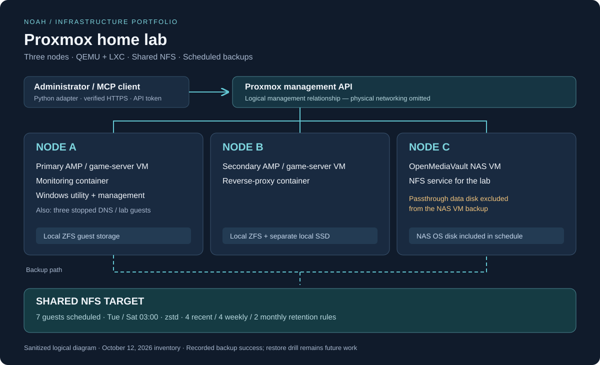

# Proxmox Home Lab

**Three-node virtualization lab with Linux and Windows workloads, shared NFS storage, service monitoring, and scheduled backups.**

I use this lab to practice infrastructure administration through running services: game hosting, a reverse proxy, monitoring, and storage. This repository explains the environment, the operational changes recorded in my lab notes, and the recovery work still to complete.

## What this demonstrates

| Area | Evidence |
| --- | --- |
| Virtualization | QEMU VMs and LXC containers distributed across three Proxmox nodes |
| Storage | Node-local ZFS storage distinguished from shared NFS; explicit backup exclusions |
| Operations | Service inventory, startup ordering, deletion protection, and guest-agent follow-up |
| Backup planning | Seven scheduled guests, documented retention, and a successful manual backup recorded in the lab notes |
| Troubleshooting | APT repository maintenance and investigation of nonresponding guest agents |
| Automation | A companion Python adapter for the Proxmox API, exposed through MCP |

## Start here

- [Architecture and design decisions](docs/architecture.md)
- [Service inventory](docs/service-map.md)
- [Storage inventory](docs/storage-map.md)
- [Backup policy and recovery plan](docs/backup-and-recovery.md)
- [Operational case studies](docs/operations.md)
- [Evidence and current limitations](docs/evidence.md)
- [Python integration](https://github.com/noaht360/proxmox-mcp) — companion repository

## Selected decisions

**Keep local and shared storage distinct.** A storage ID that exists on several nodes does not prove that it refers to one shared volume. The inventory makes that distinction explicit to avoid incorrect migration or recovery assumptions.

**Document what the backup excludes.** The NAS VM's OS disk is scheduled for backup, but its large passthrough data disk is excluded. A successful VM backup therefore does not establish protection of all NAS data.

**Make operational dependencies visible.** The recorded startup order places storage before the game servers, followed by utility and management workloads. Startup order alone does not check application readiness across nodes.

## Verification status

The source notes record a successful manual backup of the monitoring container on **October 12, 2026**, approximately **623 MB** compressed. The notes also record a scheduled job for seven guests. A full restore drill and sustained success of that schedule have **not** been established by the available evidence.

This is a documented home lab, not a claim of high availability or a production disaster-recovery implementation. The NAS is itself a VM in this environment; that creates a recovery dependency discussed in the backup plan.

## Scope and authorship

This portfolio is based on my personal lab and its operational notes. The Python companion and documentation were developed with AI assistance; the repository separates recorded lab results, offline software checks, and future work. It contains no employer or customer configurations.

Public identifiers are aliases. IP addresses, credentials, original hostnames, and exact export paths are omitted. The diagram is a logical reconstruction of the inventory, not a screenshot or a physical network wiring diagram.

**Snapshot:** source lab notes dated October 12, 2026; portfolio prepared October 17, 2026. Service states are historical observations, not live monitoring.
