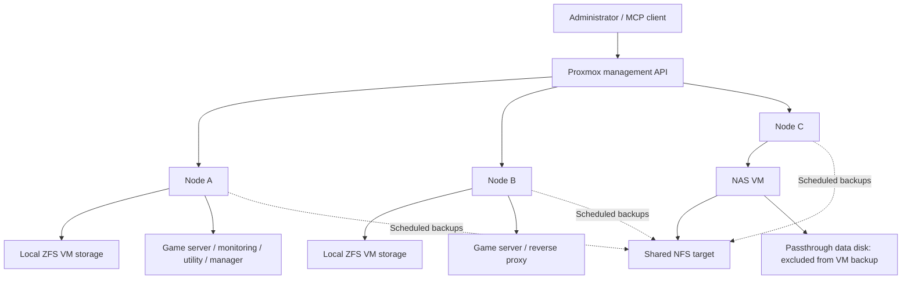

# Architecture and decisions

The documented environment contains three Proxmox nodes, ten guests, and one shared NFS storage target. Names below are public aliases.

Arrows show management or storage relationships. They do not assert network segmentation, firewall policy, or exact packet paths. The inventory also includes three stopped lab/DNS guests on Node A, omitted here for readability.

## 1. Mix VMs and containers according to workload

The inventory uses QEMU VMs for Windows, game hosting, the NAS, the management VM, and the two network/security labs. The reverse proxy, monitoring service, and paused DNS service use LXC containers. This documents the deployed layout; it does not claim performance benchmarks comparing the two virtualization methods.

## 2. Preserve storage IDs in the running environment

Human-friendly labels were added to the private inventory without renaming active storage IDs. The goal was to improve clarity while preserving existing disk references. This public repository uses aliases and is not an importable cluster configuration.

## 3. Treat the NAS as a recovery dependency

The NFS server runs inside the same lab. Keeping backups separate from a VM's local disk helps with some disk/guest failures, but is not the same as an independent off-site copy. Restoring the NAS VM requires a reachable copy of its backup and functioning access to the underlying storage. An independent bootstrap copy is proposed in the recovery plan; it is not recorded as implemented.

## 4. Observe services and expose administration separately

A monitoring container and a reverse-proxy container are present. Their existence does not prove that every endpoint has an alert, that TLS is configured correctly, or that management interfaces are isolated. Those controls require separate evidence.

## Next verification work

1. Capture sanitized configuration and service-health evidence.
2. Verify startup/readiness behavior after a controlled maintenance event.
3. Run an isolated restore drill and measure elapsed recovery time.
4. Validate an independent NAS bootstrap/off-site backup path.

No changes to the live lab were made while preparing this portfolio.
