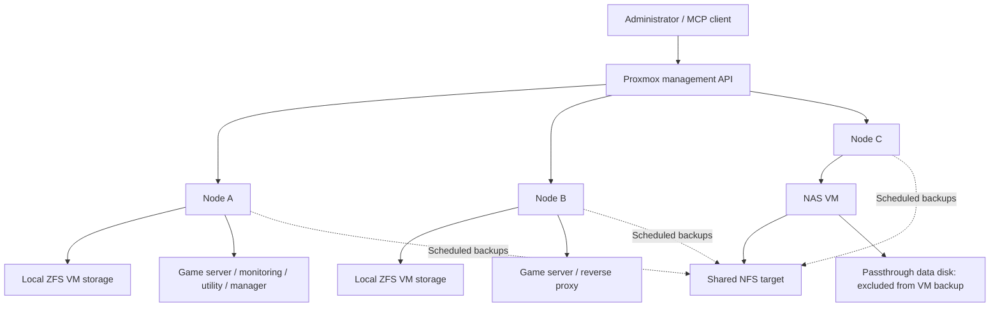

# Architecture and design decisions

The lab has three Proxmox nodes, ten guests, and a shared NFS target. The diagram shows management and storage relationships; physical networking is omitted.

## Workload placement

| Node | Workloads |
| --- | --- |
| A | Primary game server, monitoring, Windows utility VM, datacenter management, and three stopped DNS/lab guests |
| B | Secondary game server and reverse proxy |
| C | OpenMediaVault NAS VM |

Windows, game hosting, storage, management, and the network/security labs run as QEMU VMs. Monitoring, the reverse proxy, and the paused DNS service use LXC containers. The [service inventory](service-map.md) lists each guest and its operating settings.

## Local and shared storage

Nodes A and B use local ZFS storage for guest disks. The NFS target is shared across the three nodes and holds backup archives and VM images.

I added readable labels to the storage inventory while keeping the original storage IDs in Proxmox. That improved the documentation without changing existing guest-disk references. The public documentation uses aliases for those labels.

One staging-storage label appears on multiple nodes but refers to local capacity on each node. A matching label alone is not enough to treat storage as shared during a guest move.

## NAS and recovery dependencies

The NAS runs as a VM on Node C and provides the shared NFS service. This keeps storage management within the lab, but also means backup access depends on the NAS and its underlying storage.

If the NAS VM is unavailable, its OS/configuration backup needs to be reachable through an independent recovery path. Establishing that bootstrap copy is planned work. The NAS passthrough data disk also needs a separate backup because it is excluded from the VM backup.

## Supporting services

Uptime Kuma provides the monitoring service, and Nginx Proxy Manager provides the reverse-proxy service. Keeping their roles in the inventory makes it easier to identify service dependencies during maintenance.

## Startup behavior

The NAS VM has startup order 10, the game-server VMs order 20, the Windows utility VM order 30, and the management VM order 40. These are guest startup settings; application readiness and behavior across nodes still need to be tested during a controlled restart.
