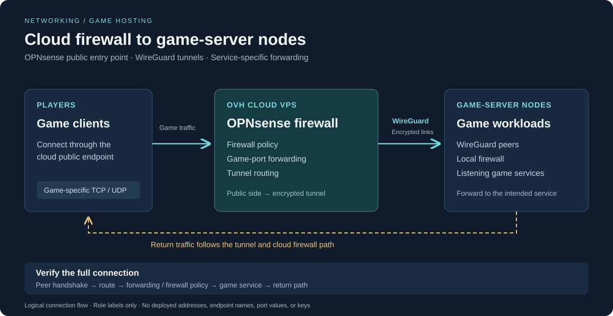

# OPNsense firewall and WireGuard tunnels

I use OPNsense on an OVH-hosted VPS as the public entry point for the game servers. WireGuard tunnels connect that cloud firewall to the game-server nodes, letting players reach the required game services through the VPS.

Names in this diagram are role labels. Addresses, endpoint hostnames, keys, and configuration exports are omitted.

## Connection flow

1. A player connects to a game service through the cloud firewall’s public endpoint.
2. OPNsense handles the firewall policy and port forwarding for the game’s required protocol and port.
3. The forwarded traffic travels over WireGuard to the appropriate game-server node.
4. The node delivers it to the listening game service, subject to its local firewall.
5. Replies need a return path through the tunnel and the cloud firewall so the player receives a consistent connection.

This separates the public connection point from the machines running the games. Each game can require different TCP or UDP ports, so the forwarding destination and service rules need to match the actual game. The tunnels provide connectivity between the cloud firewall and the nodes; the firewall’s forwarding rules determine which game service receives a connection.

## How the parts fit together

| Component | Role |
| --- | --- |
| Players | Connect to the game’s published service through the cloud endpoint |
| OVH VPS running OPNsense | Public entry point, firewall policy, and forwarding toward the game-server nodes |
| WireGuard tunnels | Encrypted links between the cloud firewall and game-server nodes |
| Peer AllowedIPs | Select destinations associated with a peer and validate source addresses received from that peer |
| Routes / gateway selection | Determine where traffic is sent |
| Firewall policy | Determines which traffic can pass between the tunnel and its destination |
| Game-server node | Hosts the game workload and receives traffic from the cloud firewall over the tunnel |
| Game service | Listens for the game’s required TCP or UDP traffic |

A working tunnel is one part of the connection. Traffic also needs the right route, a matching firewall rule, a listening service, and a return path. That separation is useful when a peer handshakes successfully but an application still cannot be reached.

## Routing and access control

WireGuard’s AllowedIPs and OPNsense’s firewall rules have different jobs. AllowedIPs associate traffic with a peer; firewall policy controls permitted connections. Routing must also send the traffic through the intended interface or gateway.

For a game connection, work through four questions:

1. Which source and destination need to communicate?
2. Which peer and route should carry that traffic?
3. Which protocol and service does the firewall need to allow?
4. How will the destination’s reply get back to the source?

NAT belongs in that analysis where address translation is needed. A forwarded request can reach a service while its reply takes a different path, so checking only the inbound direction can miss the problem. OPNsense’s [selective-routing guide](https://docs.opnsense.org/manual/how-tos/wireguard-selective-routing.html) explains how peer settings, gateways, firewall rules, and NAT interact.

## Troubleshooting path

| Symptom | What to inspect |
| --- | --- |
| No recent handshake after sending traffic | Peer availability, UDP reachability, endpoint configuration, and whether the configured peer keys match |
| Handshake succeeds but the service is unreachable | AllowedIPs, routes, the relevant ingress firewall rules, and the destination host’s firewall |
| Requests arrive but replies do not | Destination gateway, return routes, NAT, and state handling |
| Small packets work but larger transfers stall | Tunnel MTU, path MTU discovery, and TCP MSS where applicable |
| Connection stops working after idle time | NAT mapping expiry and whether persistent keepalive is needed |

Check from both ends and follow one connection at a time. Handshake timestamps show peer communication; transfer counters show tunnel traffic; packet captures help locate where a specific request or reply stops. A recent handshake alone does not verify the application connection.

## Adding or changing a game service

The workflow is to identify the game’s required protocol and ports, choose the destination node, check its listening service and local firewall, then match the cloud forwarding policy and tunnel route to that destination. Validate from an external client and check both the incoming connection and its replies.

This procedure describes how to reason through the setup; deployed port numbers and rule values stay in the private configuration.

## What this adds to the lab

The setup connects cloud-hosted networking with game workloads running on separate nodes. It brings together firewall administration, port forwarding, VPN connectivity, routing, and service troubleshooting alongside the VM and storage work in the rest of the lab.

## References

- [OPNsense WireGuard site-to-site setup](https://docs.opnsense.org/manual/how-tos/wireguard-s2s.html)
- [OPNsense selective routing](https://docs.opnsense.org/manual/how-tos/wireguard-selective-routing.html)
- [OPNsense NAT](https://docs.opnsense.org/manual/nat.html)
- [WireGuard quick start and persistent keepalive](https://www.wireguard.com/quickstart/)
